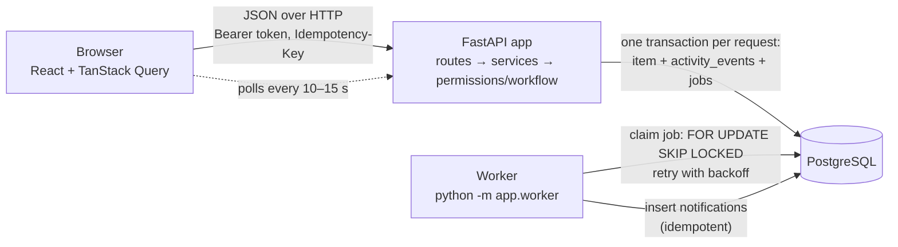

# Newtonite Ops: Operations Under Pressure

An internal web app for creating, assigning, tracking and resolving operational work items
(incidents, customer issues, payments, compliance, tasks) across teams. Each item moves through a
server-enforced workflow with a Lead-only approval step. Every change is recorded in an append-only
history, and the dashboard shows each person what needs their attention. It is built to behave
correctly when people collide: concurrent claims, stale edits, double-clicks and retries.

**Stack:** FastAPI (Python) · PostgreSQL 16 · SQLAlchemy + Alembic · React + TanStack Query ·
Postgres-backed outbox worker · Pytest · Docker Compose

- Design decisions and trade-offs: [ENGINEERING_DECISIONS.md](ENGINEERING_DECISIONS.md)

---

## Run it

**Prerequisites:** Docker Desktop (or Docker Engine with Compose v2). Ports `8000` and `5434` must
be free (to change them, copy `.env.example` to `.env` and edit `APP_PORT` / `DB_PORT`).

```bash
docker compose up --build
```

Then open **http://localhost:8000**.

The first start builds the images, runs the database migration, and seeds the demo data
(4 teams, 10 users, ~5,000 work items with history). That takes about a minute; after that, startup
takes a few seconds. API docs (Swagger) are at http://localhost:8000/docs.

| Task | Command |
|---|---|
| Stop | `docker compose down` |
| Reset the demo data | `docker compose exec app python -m app.seed --reset` |
| Wipe everything (including the database volume) | `docker compose down -v` |
| Worker logs | `docker compose logs -f worker` |

## Demo logins

Every demo user's password is **`demo1234`** (demo data only).

| Username | Teams and roles |
|---|---|
| `ada` | **Admin** in all four teams |
| `priya` | **Lead** in Payments Ops · Member in Compliance |
| `sam` | **Lead** in Customer Support and Payments Ops |
| `lin` | **Lead** in Compliance and Platform |
| `maya` | Member in Payments Ops |
| `omar` | Member in Payments Ops and Customer Support |
| `jules` | Member in Customer Support |
| `kai` | Member in Platform and Compliance |
| `noah` | Member in Platform |
| `vera` | **Viewer** in Payments Ops and Customer Support |

## Run the tests

```bash
docker compose run --rm app pytest
```

The 41 API-level tests run against a real Postgres test database (`ops_test`, created automatically),
because the concurrency behaviour depends on real row locks and transactions. They cover:

| Area | File | Examples |
|---|---|---|
| Concurrency | `test_concurrency.py` | 6 parallel claims → exactly one wins; stale edit → 409 and data unchanged; parallel edits on the same version → one lands |
| Idempotency | `test_idempotency.py` | same key twice → one item, same response; same key 5× in parallel → one item; key reused with a different body → 422 |
| Workflow | `test_workflow.py` | open → closed rejected; member cannot approve; Lead cannot approve own work; start requires an assignee |
| Authorization | `test_authorization.py` | other team → 404 on every read/write; viewer → 403 on writes; only Leads assign others |
| Lists and history | `test_items.py` | cursor pagination returns every row exactly once; full-text search; dashboard views; history is append-only |
| Async worker | `test_worker.py` | job runs once even if processed twice; failing job retries with backoff, then `failed`; crashed worker's job is picked up again |

## Try the critical behaviours (2-minute demo)

1. **Concurrent claim.** Log in as `maya` in one browser and `omar` in a private window. Both open
   *"Card payments failing for EU merchants"* and click **Claim** at the same time. One gets it. The
   other sees *"Already claimed by someone else"*, and their screen rolls back to show the winner.
2. **Stale edit.** Both open *"Settlement file for 18 Oct is missing"* and click **Edit**. Maya saves
   first. When Omar saves, he gets *"This item was changed by someone else… Your changes were not saved"*,
   with a button to reload. The warning also appears while he is still typing, once the page refreshes.
3. **Approval.** As `maya`, open *"Settlement file…"* → **Submit for approval**. Log in as `priya`:
   it appears under **Awaiting my approval** and in **Notifications** (delivered by the worker).
   Approve it, and Maya gets a notification. Maya herself sees no Approve button, and the API would
   refuse it anyway.
4. **Authorization.** `vera` (viewer) can read Payments items but has no action buttons. `kai` (no
   Payments role) cannot see Payments items at all; opening one by URL gives "Item not found".

## Architecture



- The browser never decides anything important. It shows what the API returns, including a `can`
  object that says which buttons to show. The server re-checks every action.
- Each write request is **one database transaction**: the item change, its history rows, and any outbox
  job are committed together or not at all.
- The **worker** is a separate process that reads the `jobs` table (the outbox) and delivers
  notifications, with retries.

### How a request flows through the code (example: Claim)

1. `POST /api/items/42/claim` → `claim_item` in [`backend/app/api/routes.py`](backend/app/api/routes.py)
2. `current_user()` turns the bearer token into the user and their role in each team.
3. `mutate()` handles the `Idempotency-Key` (replay if seen before) and commits once at the end.
4. `items.claim_item()` in [`backend/app/services/items.py`](backend/app/services/items.py):
   - `load_item()` → `permissions.require(user, item.team_id, "claim")` (404 outside the team, 403 if viewer)
   - `_guarded_update(... assignee_id IS NULL ...)`: a single `UPDATE ... WHERE ... RETURNING`.
     If 0 rows changed, someone else claimed it first → 409 with the current item.
   - `record_change()` appends the history row in the same transaction.

## Project layout

```
docker-compose.yml        db (Postgres) + app (API & UI) + worker
Dockerfile                builds the React app, then the Python image that serves it
backend/
  migrations/versions/    0001_initial_schema.py: every table, constraint, index and trigger (plain SQL)
  app/
    main.py               FastAPI app, error → JSON handler, serves the React build
    api/routes.py         HTTP endpoints (thin), mutate() = transaction + idempotency
    api/schemas.py        request validation (Pydantic)
    api/serializers.py    item → JSON, including the "can" (allowed actions) block
    services/items.py     the use-cases: create, list, edit, claim, transition, comment, history
    services/idempotency.py
    services/auth.py      login / logout / token → user
    permissions.py        roles and the single require() check
    workflow.py           allowed status transitions and who may make them
    worker.py             outbox worker (lease, retries, backoff, idempotent handlers)
    seed.py               demo data
  tests/                  pytest suite (see above)
frontend/src/
  api.js                  fetch wrapper: token, Idempotency-Key, ApiError (code + current item)
  auth.jsx                login state
  pages/DashboardPage.jsx "Needs attention" panels + notifications
  pages/ItemsPage.jsx     filters in the URL, server-side search, "Load more" (keyset cursor)
  pages/NewItemPage.jsx   create form (one idempotency key per form)
  pages/ItemPage.jsx      detail, optimistic claim/transition with rollback, edit with version check, timeline
```

## API overview

All endpoints are under `/api` and need `Authorization: Bearer <token>` (except login).
Full interactive docs: http://localhost:8000/docs

| Method | Path | Notes |
|---|---|---|
| POST | `/auth/login` | `{username, password}` → `{token, user}` |
| POST | `/auth/logout` | revokes the token |
| GET | `/me` | current user and their team roles |
| GET | `/items` | `view=assigned_to_me\|unassigned_urgent\|awaiting_my_approval`, `team_id`, `status`, `priority`, `type` (repeatable), `assignee=me\|none\|<id>`, `q` (full-text), `cursor`, `limit` |
| POST | `/items` | create; optional `Idempotency-Key` |
| GET | `/items/{id}` | item and the actions the caller may take (`can`) |
| PATCH | `/items/{id}` | `{version, ...changed fields}`; 409 `version_conflict` with `current` if stale |
| POST | `/items/{id}/claim` | atomic; 409 `already_claimed` if someone was faster |
| POST | `/items/{id}/transition` | `{to_status, version}`; 409 `invalid_transition` / 403 if not allowed |
| GET | `/items/{id}/activity` | history, newest first, `before=<event id>` for older |
| POST | `/items/{id}/comments` | `{body}`; optional `Idempotency-Key` |
| GET | `/teams/{id}/members` | for the assignee picker |
| GET | `/notifications` | delivered by the worker |

Errors are always JSON: `{"code": "...", "detail": "human-readable reason", "current": {...}}`
(`current` is only present on conflicts).

## Local development without Docker for the app (optional)

Requires Python 3.11+ and Node 20+. The database still runs in Docker:

```bash
docker compose up -d db
cd backend
python -m venv .venv
.venv\Scripts\Activate.ps1                           # Windows PowerShell; macOS/Linux: source .venv/bin/activate
pip install -r requirements.txt
python -m alembic upgrade head
python -m app.seed
uvicorn app.main:app --reload                        # API on :8000
python -m app.worker                                 # in a second terminal
python -m pytest                                     # tests (uses the ops_test database)
cd ../frontend && npm install && npm run dev         # UI on :5173 (proxies /api to :8000)
```

## Known limitations

- Notifications are in-app only (no email or Slack), and there is no "mark as read".
- No admin screens for users, teams or memberships. These come from the seed script.
- Lists have one sort order (newest first) and no total counts (deliberate: counting is expensive at scale).
- Two people editing *different* fields at the same time still conflict: no field-level merge.
- Updates arrive by polling every 10–15 seconds, not in real time.
- The login token is stored in `localStorage` (simple, but readable by injected scripts; httpOnly
  cookies would be safer). There are no refresh tokens and no rate limiting on login.
- Search is English full-text only, with no typo tolerance.
- The frontend has no automated tests. Critical behaviour is tested at the API level.
- A member's role is read at the start of each request, so a role change applies from the next request.

## Next week I would…

- Add frontend tests (Vitest + Testing Library) for the optimistic rollback and the conflict banner.
- Merge non-overlapping field edits instead of rejecting them.
- Add admin screens for teams and memberships, with role changes in the audit log.
- Push updates with Server-Sent Events instead of polling.
- Deliver email/Slack from the outbox, passing the job id as the provider's idempotency key.
- Add Postgres Row-Level Security as a second authorization layer, plus httpOnly cookie sessions and
  login rate limiting.
- Load-test with 1M items, partition `activity_events` by month, and add due-date / SLA escalation jobs.
